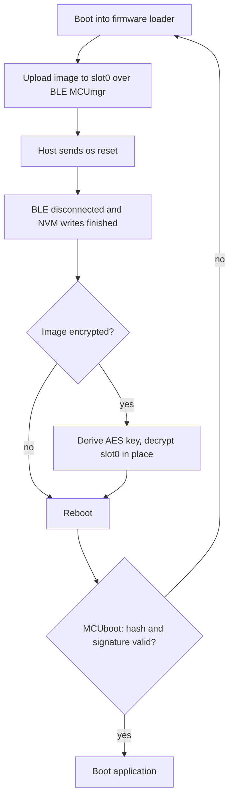

# Image Encryption on nRF Connect SDK Bare Metal

Reference project for firmware image encryption with nRF Connect SDK Bare Metal (NCS BM) v2.0.1. <br>
Sample based on the upstream `mcuboot_recovery_entry` sample (see [README.rst](README.rst) for the base behavior: BLE advertising, MCUmgr, reboot into the firmware loader) extended with:

* Supporting encrypted application images (AES-128-CTR, ECIES-X25519 key exchange), built by MCUboot's `imgtool`.
* In-place decryption of the uploaded image in the BLE firmware loader, before MCUboot validates and boots it.
* Board overlays for a larger firmware loader partition (slot1) on nRF54L15 and nRF54LM20, required for debugging / logging enabled.

Forked SDK that includes the image encryption feature: https://github.com/kkotinkar/sdk-nrf-bm (branch: feature/image_enc).

## 1. Implementation Status

* Image encryption/decryption (AES-128-CTR) using the native MCUboot code (`bootutil`), added for NCS BM.
* Based on NCS BM release v2.0.1, using a modified firmware loader application.
* The decryption hook is only called from the Bluetooth LE firmware loader (`ble_mcumgr`). The UART loader does not use the hook today.
* The ENC TLV 0x33 is used (ECIES-X25519, HKDF/HMAC-SHA256 key exchange), hard-coded at build time. TLV 0x34 (SHA512) and AES-256 are not supported, an AES-256 image is rejected.
* The firmware loader (slot1) needs more space than before for the key handling and decryption code.<br>
  For nRF54LM20, the loader is about 58.5 KB with logging disabled (`CONFIG_LOG=n`) and about 67 KB with minimal logging.<br>
  This project uses a 72 KB slot1 to accommodate logging / development scenarios, see [Partitions](#partitions).
* KMU is not used for the device private key, instead it is stored in the boot partition following MCUboot's upstream implementation.<br>MCUboot's signature verification does use the KMU.
* Tested on nRF54L15-DK (nRF54L15) and nRF54LM20-DK (nRF54LM20A) with their respective BM SDK targets.

#### Open TODOs:
* Decryption speed is limited because the SoftDevice is initialized while decrypting.
* NCS BM v2.0.1 does not offer the UICR `BOOTCONF` lock for nRF54LM20 (Kconfig dependency), it is available for nRF54L15.

## 2. Setup of patched SDK

1. Install the nRF Connect toolchain v3.3.0 and NCS BM v2.0.1, for example with `nrfutil sdk-manager`.
   <br>This creates the workspace, for example `~/sdk/nrf-bm/v2.0.1`, with its manifest repository in `nrf-bm`.
2. Switch the `nrf-bm` repository to the branch with the image encryption feature.<br>
   The manifest repository cannot be redirected from its own `west.yml`, so check out the branch instead:

   ```
   cd ~/sdk/nrf-bm/v2.0.1/nrf-bm
   git remote add kkotinkar https://github.com/kkotinkar/sdk-nrf-bm
   git fetch kkotinkar feature/image_enc
   git checkout -b feature/image_enc kkotinkar/feature/image_enc
   ```

   The SDK patch only changes files inside `nrf-bm`.<br>
   View the modified files compared to the v2.0.1 release:
   
   ```
   git diff --stat v2.0.1
   git diff --name-status v2.0.1
   ```

   To return to the stock SDK: `git checkout v2.0.1`.

### Partitions

The firmware loader runs from slot1 and the application from slot0.
This project increases slot1 from 64 KB to 72 KB (needed when logging is enabled), and reduces slot0 by 8 KB.<br>
The layout is anchored at the end of the RRAM (metadata, SoftDevice, slot1, slot0), so slot1 address and slot0 size are SoC specific:

| SoC | slot0 (app)<br>start / size | slot1 (fw loader)<br>start / size | SoftDevice S145<br>start / size |
| --- | --- | --- | --- |
| nRF54L15 | `0x00a000` / 1272 KB | `0x148000` / 72 KB | `0x15a000` / 139.5 KB |
| nRF54LM20A | `0x00a000` / 1784 KB | `0x1c8000` / 72 KB | `0x1da000` / 139.5 KB |

* The overlays are in [boards/](boards/), named after the board target.
  The application picks them up automatically.
* [sysbuild.cmake](sysbuild.cmake) passes the same overlay to `mcuboot`, `firmware_loader` and `installer`, so all images use the same layout.
* Other boards need their own overlay file with the same name pattern.
* The boot partition (31 KB) holds MCUboot and, in its last `0x100` bytes (`0x7b00`), the device key record.

## 3. Image encryption usage

1. Generate the device key pair (X25519), the private key stays with the device provisioning, the public key goes to the build:

   ```
   python3 ~/sdk/nrf-bm/v2.0.1/bootloader/mcuboot/scripts/imgtool.py keygen -k enc-x25519-priv.pem -t x25519
   python3 ~/sdk/nrf-bm/v2.0.1/bootloader/mcuboot/scripts/imgtool.py getpub -k enc-x25519-priv.pem -e pem -o enc-x25519-pub.pem
   ```

2. Enable the image encryption feature in `sysbuild.conf`, and point to the private key (absolute path, or relative to this directory), example:

   ```
   SB_CONFIG_BM_FIRMWARE_LOADER_IMAGE_DECRYPTION=y
   SB_CONFIG_BM_FIRMWARE_LOADER_ENC_KEY_FILE="./enc-x25519-priv.pem"
   ```

3. In `prj.conf`, set the application image version and the public key for the encryption step of the build, example:

   ```
   CONFIG_MCUBOOT_IMGTOOL_SIGN_VERSION="1.0.0+0"
   CONFIG_MCUBOOT_ENCRYPTION_KEY_FILE="./enc-x25519-pub.pem"
   ```

4. Recommended for production: Protect the device and lock the boot partition (`sysbuild.conf`):

   ```
   SB_CONFIG_APPROTECT_LOCK=y
   SB_CONFIG_SECURE_APPROTECT_LOCK=y
   SB_CONFIG_BM_BOOT_BOOTCONF_LOCK_WRITES=y    # nRF54L15 only in NCS BM v2.0.1
   ```

   With AP protect enabled, you need `nrfutil device recover` before programming a device again.

Keep the firmware loader configuration of this project as is: the size-optimized loader configuration (`FILE_SUFFIX=size_opt`) from the SDK is not compatible with the encryption feature.
Extended logging of the firmware loader is off by default, and enabling it will exceed the 72 KB slot1 partition on the nRF54LM20.

### Build and program

Target: nRF54L15 + MCUBoot + S145
```
west build -p -b bm_nrf54l15dk/nrf54l15/cpuapp/s145_softdevice/mcuboot
```

Target: nRF54LM20 + MCUBoot + S145
```
west build -p -b bm_nrf54lm20dk/nrf54lm20a/cpuapp/s145_softdevice/mcuboot
```

Build outputs:

| File | Content |
| --- | --- |
| `build/production.hex` | MCUboot (with key record), SoftDevice, firmware loader, application, metadata, UICR |
| `build/mcuboot_enc_dfu/zephyr/zephyr.signed.encrypted.bin` | Encrypted and signed application binary |
| `build/installer_softdevice_firmware_loader.bin` | SoftDevice and firmware loader update binary |
| `build/keyfile.json` | KMU keys for MCUboot's signature verification |

The build log prints the key record, for example `Encryption key record: 56 of 256 bytes used at 0x7b00`.
The build fails if MCUboot grows into the key area.

Program a device with the combined hex file, always from the same build as the key file:

```
nrfutil device recover                  # if device protection is active
nrfutil device program --firmware build/production.hex --options chip_erase_mode=ERASE_ALL
nrfutil device x-provision-keys --key-file build/keyfile.json
nrfutil device reset
```

Flash `production.hex` with erase all: programming single images does not carry the key record.

### Update with an encrypted image

1. Build the application with a changed version (`CONFIG_MCUBOOT_IMGTOOL_SIGN_VERSION`).
2. Reboot the device into the firmware loader, as described in [README.rst](README.rst) (nRF Connect Device Manager, `Switch to Firmware Loader mode`).
3. Upload `zephyr.signed.encrypted.bin` as `Image 0`. An unencrypted `zephyr.signed.bin` is still accepted.
4. Send the reset command from Device Manager. The loader decrypts the image after the reset command, then reboots into the application.

### Verify the images

MCUboot's imgtool:
```
python3 ~/sdk/nrf-bm/v2.0.1/bootloader/mcuboot/scripts/imgtool.py dumpinfo build/mcuboot_enc_dfu/zephyr/zephyr.signed.encrypted.bin
```

The encrypted image has the `ENCRYPTED_AES128` flag and a `TLV_ENC_X25519` (0x33) entry.

### Large image DFU test (optional)

[src/pad.c](src/pad.c) adds a constant array that fills slot0 close to its limit. This is used to measure the decryption time of a near slot sized image.
Uncomment the `src/pad.c` line in [CMakeLists.txt](CMakeLists.txt) to enable it.
The decryption work buffer size can be changed with `CONFIG_APP_FIRMWARE_LOADER_ENC_CHUNK_SIZE` (default 512, up to 4096).

## 4. How it works

The firmware loader (`nrf-bm/applications/firmware_loader/ble_mcumgr`) calls `enc_image_decrypt_slot0()` at the end of `main()` in `src/main.c`.



1. The device boots into the firmware loader mode.
2. A new image, encrypted or not, is transferred to slot0.
3. The hook does not run right after the transfer. It runs after the host sent the reset command, the BLE peer is disconnected and all NVM writes have finished.
4. `enc_image_decrypt_slot0()` checks the image header in slot0:
   * Not encrypted: nothing is changed, the loader continues as before.
   * Encrypted: the AES key is derived and the payload is decrypted in place:
     1. Find the ENC TLV (0x33) with the ephemeral public key, MAC tag and wrapped AES key.
     2. Import the device private key from the key record in the boot partition.
     3. ECDH with the ephemeral key, then HKDF to get the key encryption key and the HMAC key.
     4. Verify the MAC over the wrapped key, unwrap the AES-128 key.
     5. Decrypt the payload in chunks, in place. The header and the TLVs are not encrypted.
5. If the first decrypted block is not a plausible vector table, the payload is taken as already decrypted and is left as is.
   This is the case for the image in `production.hex`, which is programmed as plaintext with the `ENCRYPTED` flag set.
6. The loader reboots in every case, and MCUboot boots slot0.
7. The hash and signature cover the plaintext image. An image that is still encrypted, or only partly decrypted, fails the validation and is not booted: MCUboot enters the firmware loader again, and the procedure restarts.
   The `ENCRYPTED` flag stays in the header after decryption. The BM MCUboot path does not check it and does not decrypt on the fly (`MCUBOOT_ENC_IMAGES` is not enabled), so no MCUboot change is needed.

## 5. Security notes

* The device private key is stored in RRAM memory (non-volatile) in the last `0x100` bytes of the boot partition. Protect the device with AP protect, and lock the boot partition with `SB_CONFIG_BM_BOOT_BOOTCONF_LOCK_WRITES` where available.
  Do not distribute `production.hex` outside of provisioning.
* Keep the `*.pem` files out of version control (they are ignored in this project). Do not use the default MCUboot keys either.
* The build fails if no encryption key file is configured, and warns if MCUboot's default development key (`enc-x25519-priv.pem` of the MCUboot module) is used. That key is public and must not be used for products.
* A key change requires programming the device again.

## 6. Test scope

- Unit and integration tests of `enc_image.c` routines were performed using the `native_sim` backend.
- Additionally, the code has been tested on:
  - **nRF54LM20-DK**
    - SoC: `nRF54LM20A`
    - Board target: `bm_nrf54lm20dk/nrf54lm20a/cpuapp/s145_softdevice/mcuboot`
  - **nRF54L15-DK**
    - SoC: `nRF54L15`
    - Board target: `bm_nrf54l15dk/nrf54l15/cpuapp/s145_softdevice/mcuboot`